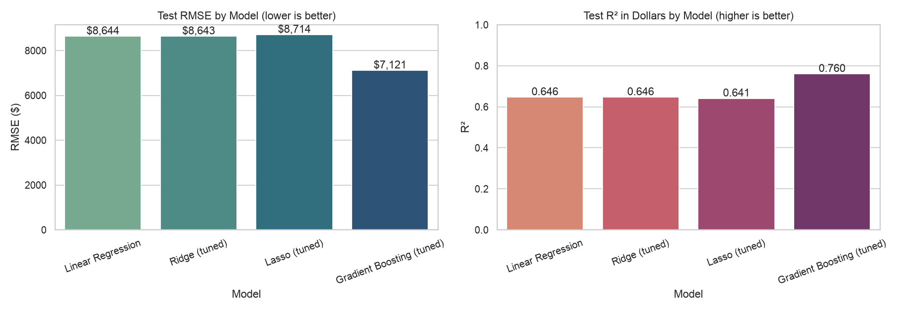
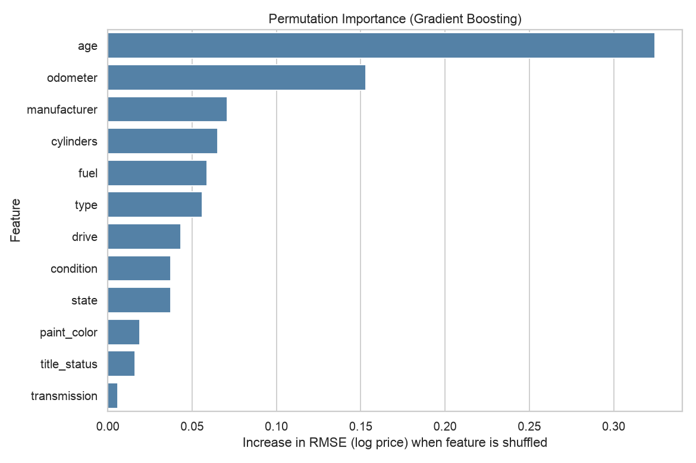
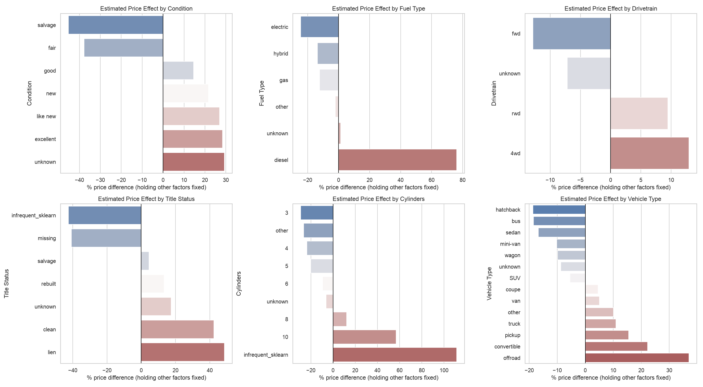

# What Drives the Price of a Used Car?

An analysis of ~426K used-car listings (Kaggle) to tell a used car dealership which vehicle attributes consumers value most, following the CRISP-DM process.

**Full analysis:** [`notebooks/used_car_price_analysis.ipynb`](notebooks/used_car_price_analysis.ipynb)

## Business problem
Which characteristics of a used car (age, mileage, brand, condition, drivetrain, and so on) move its price, and by how much? The answer should help a dealership decide what to stock, what to pay, and how to price.

## Approach
1. **Data understanding:** about 427K listings, 18 columns. Several columns are 30-70% blank, and `price`, `odometer` and `year` contain junk values (prices of $0 and up to $3.7 billion, 10-million-mile odometers).
2. **Data preparation:** removed unrealistic prices (kept $500-$150,000), mileage (1-300,000) and pre-1990 vehicles; dropped identifier or unusable columns; filled blank categories with `"unknown"`; created `age`; removed duplicates. This left **255,640 listings**.
3. **Modeling:** predicted log(price) with Linear Regression, Ridge and Lasso (grid search and cross-validation), plus gradient boosting as a non-linear benchmark.
4. **Evaluation metric:** RMSE in dollars on a held-out 20% test set (MAE and R² as support). RMSE is in price units and penalizes large, costly mispricings.

| Model | Test RMSE | Test MAE | R² |
|---|---|---|---|
| Linear Regression | $8,644 | $4,947 | 0.65 |
| Ridge (tuned) | $8,644 | $4,947 | 0.65 |
| Lasso (tuned) | $8,714 | $4,966 | 0.64 |
| **Gradient Boosting (tuned)** | **$7,174** | **$3,859** | **0.76** |

The best model's median error is about 17% of price, and 57% of test cars are predicted within 20% of the asking price.



## Key findings (for dealers)
- **Age and mileage dominate.** Each extra year of age lowers price by about **6.5%**, and each extra 10,000 miles by about **3.8%**. Median asking prices are about $38k at 1 year old, $25k at 5 years, $11.5k at 10 years and $6.6k at 15 years.
- **Next most important:** manufacturer, engine size (cylinders), fuel type, body style, drivetrain and condition.
- **Higher-priced segments:** pickups, off-road vehicles and convertibles; 4WD; V8 and diesel; Porsche, Tesla, Lexus, Audi and Mercedes-Benz.
- **Lower-priced segments:** sedans, hatchbacks, front-wheel drive, 4-cylinder cars; Fiat, Mercury, Saturn, Mitsubishi, Kia and Hyundai.
- **Condition and title matter.** Excellent-condition cars are priced about double comparable fair-condition cars. Rebuilt titles are priced about 20% below clean titles, and salvage titles about 27% below.
- **Paint color and transmission have small effects** (a few percent).




## Recommendations
1. Make age and mileage the first filter when buying inventory and setting prices.
2. Trucks, 4WD and similar body styles carry higher prices; expect lower prices on small sedans and hatchbacks. Check margins before shifting inventory toward them.
3. Invest in reconditioning that moves a car up a condition grade, and be careful paying clean-title prices for rebuilt or salvage cars.
4. Use the model as a *starting-point* price guide, not a replacement for local market judgement.
5. Check profit margin and turn speed before shifting inventory toward premium brands, since this analysis shows prices, not profit.

## Limitations and next steps
- Prices are online *asking* prices, not final sale prices, and about 40% of the raw rows were removed in cleaning.
- Vehicle model/trim was not used (thousands of free-text values) and is likely the biggest missing driver of accuracy.
- Next steps: add cleaned model/trim, use sold-price and days-on-lot data, analyze regional differences, widen the hyperparameter search, and add age x mileage interactions to the linear model.

## Repository structure
```
.
├── README.md
├── requirements.txt
├── data/
│   └── vehicles.csv                       # source data (Kaggle used cars sample, 426K rows)
├── images/                                # charts used in the README and notebook
└── notebooks/
    └── used_car_price_analysis.ipynb      # full CRISP-DM analysis
```

## How to run
```bash
pip install -r requirements.txt
jupyter notebook notebooks/used_car_price_analysis.ipynb
```
Run the notebook from the `notebooks/` folder so the relative data path (`../data/vehicles.csv`) resolves. The model-tuning cells can take several minutes.
